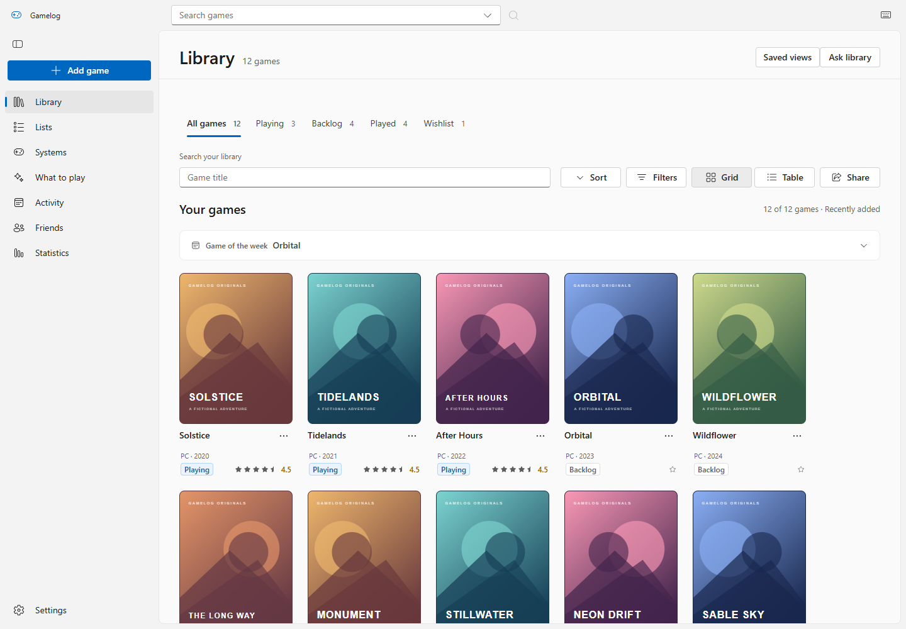
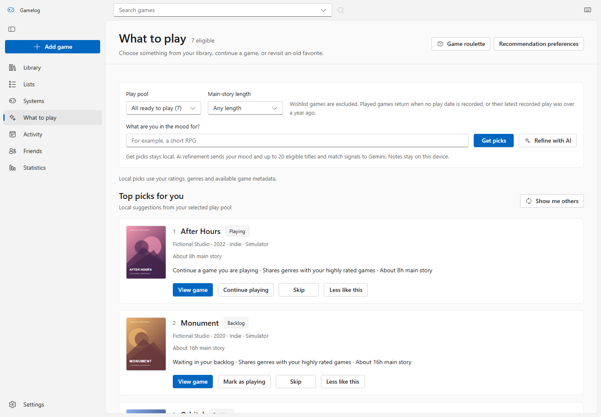
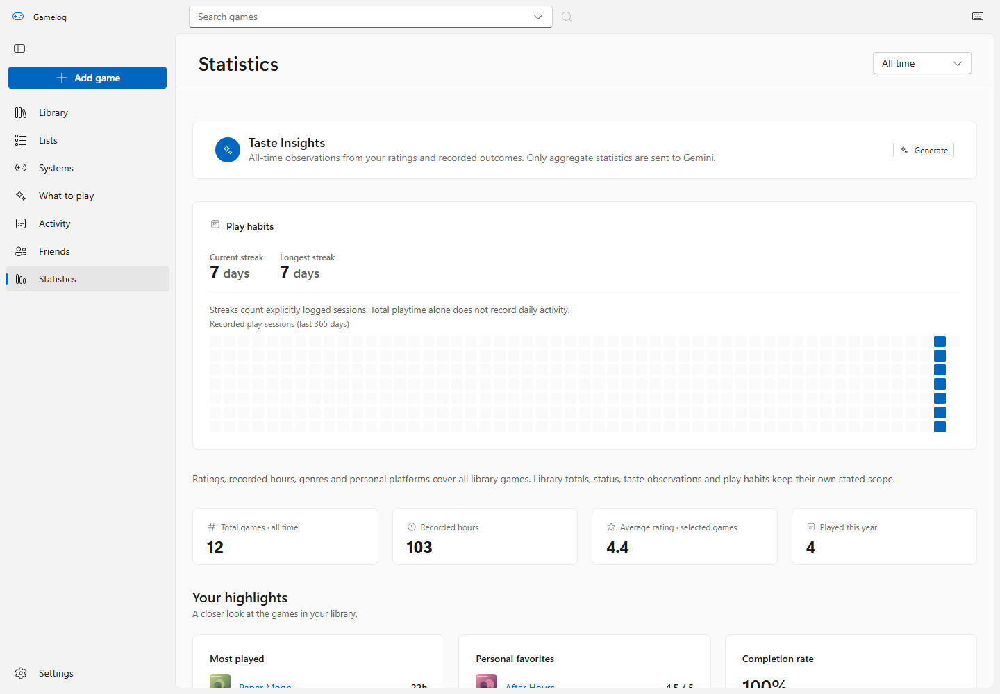
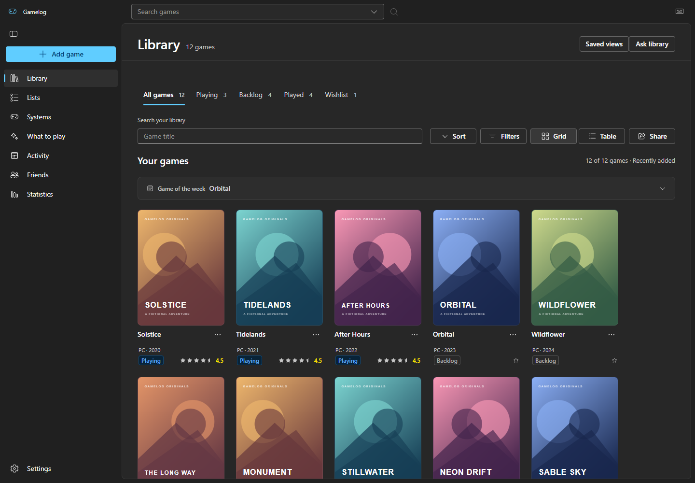
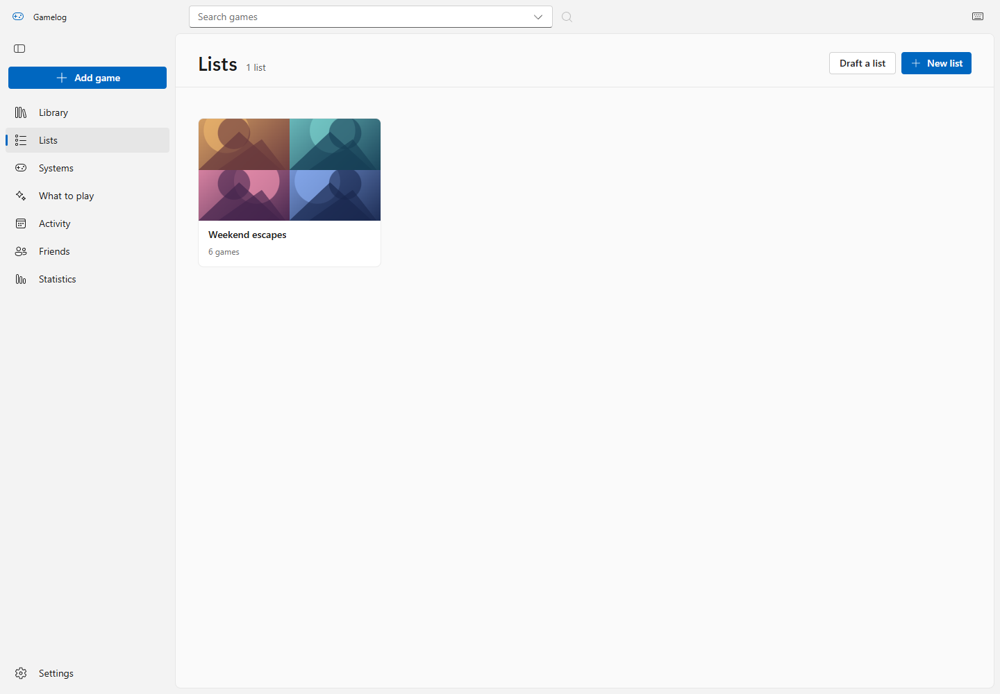

# Gamelog

### A considered home for your games, your play history, and what comes next.

Gamelog is a Windows desktop app for organizing a game library, keeping a play journal, and choosing what to play. It brings collection management and personal reflection into one local-first experience, with optional AI assistance under the player's control.

**Product design · Interaction design · Design systems · Working prototype**



_Actual production app. All screenshots use fictional games, original sample artwork and invented play records. No personal library is included._

[Read the design case study](docs/CASE-STUDY.md) · [Explore the design system](docs/design-system/README.md) · [Run it locally](#run-it-locally)

## The product idea

A growing game library can become a list of decisions postponed. Gamelog connects three jobs: **organize what you own, remember what you played, and decide what deserves your next session.**

The interface keeps catalog information separate from personal records. Browsing a game does not add it to the library. Logging status does not invent play history. Recommendations explain their signals, and AI suggestions remain drafts for review.

| Experience               | Design intent                                                                                                                                       |
| ------------------------ | --------------------------------------------------------------------------------------------------------------------------------------------------- |
| Library                  | Cover browsing and a sortable table support recognition and comparison. Status tabs, combined filters and saved views keep a collection manageable. |
| Play journal             | Notes, ratings, sessions and completion states preserve the player's own account of a game.                                                         |
| What to play             | Local recommendations use eligible games, available time and taste signals. Optional AI refinement is an explicit action.                           |
| Lists and sharing        | Curated and ranked collections offer an editorial layer beyond automatic sorting.                                                                   |
| Activity and statistics  | Recorded sessions and scoped summaries turn collection data into a personal reflection tool.                                                        |
| Recovery and portability | Export/import, undo and recovery protect personal records.                                                                                          |

## A closer look

| Choose a next session                                                                              | Reflect on your library                                                                               |
| -------------------------------------------------------------------------------------------------- | ----------------------------------------------------------------------------------------------------- |
|  |  |

<details>
<summary>Dark mode and curated collections</summary>





</details>

## Run it locally

Use **Node.js 24 LTS** and npm. Windows is the supported desktop target; the browser version supports development and review.

```sh
npm ci
npm run dev:web
```

Open the local URL printed by the server. The app starts with an empty library. To explore it without credentials, import [`examples/demo-library.json`](examples/demo-library.json) from **Settings → Import backup → Merge (Add & Update)**. This adds 12 fictional games, sample logs and a collection. Use a separate browser profile for a clean demo.

### Bring your own API credentials

The app includes no shared service keys. Copy `.env.example` to `.env`, add your own values, then restart.

```powershell
Copy-Item .env.example .env
```

| Variable                                | Enables                                                                  | Needed for demo? |
| --------------------------------------- | ------------------------------------------------------------------------ | ---------------- |
| `IGDB_CLIENT_ID` + `IGDB_CLIENT_SECRET` | Catalog search and online details through a Twitch developer application | No               |
| `GEMINI_API_KEY`                        | Optional AI parsing, recommendations, recaps and embeddings              | No               |
| `STEAM_WEB_API_KEY`                     | Steam library import; the profile's game details must be public          | No               |

Credentials stay on the local server and are excluded from the renderer and desktop package. Never use a `VITE_PUBLIC_` variable for a secret. The sample library, editing, lists, local recommendations, statistics and backups work without service credentials. Online catalog, AI and Steam requests require the relevant credentials and internet. Optional deal lookups contact CheapShark separately.

See [desktop setup](docs/DESKTOP-SETUP.md) for packaged-app configuration.

## Project structure

```text
src/          React screens, shared UI, design tokens and local data services
server/       Local API handlers for IGDB, Gemini and Steam
electron/    Windows desktop shell and private runtime configuration
tests/       Unit, API and browser regression coverage
scripts/     Build checks, desktop verification and publication tools
docs/        Case study, design system, screenshots and setup guides
examples/    Fictional, offline-ready demo library
build/       Application icon source
```

React 19, TypeScript, Fluent UI, Dexie/IndexedDB, Vite, Express and Electron. Screens load on demand; browser and desktop builds share the local API handlers. See [architecture](docs/ARCHITECTURE.md).

## Development and verification

| Command                      | Purpose                                                      |
| ---------------------------- | ------------------------------------------------------------ |
| `npm run dev`                | Start the Electron development app                           |
| `npm run dev:web`            | Start the browser app and local API routes                   |
| `npm run check`              | Type checking, lint and unit/API tests                       |
| `npm run build`              | Build browser/desktop code; check assets and compiled server |
| `npm run test:ui:production` | Build and test the production browser app                    |
| `npm run test:desktop`       | Check a built desktop app with a temporary profile           |
| `npm run build:desktop`      | Build a Windows installer                                    |
| `npm run screenshots`        | Recreate portfolio screenshots using fictional data          |
| `npm run check:publication`  | Scan public source for recognized secrets/private files      |
| `npm run export:github`      | Create source-only output without local files or Git history |

Install Playwright's browser with `npx playwright install chromium` on non-Windows systems. Windows tests use installed Microsoft Edge by default. GitHub Actions checks the production browser app and Windows desktop. [Verification details](docs/VERIFICATION.md).

## Data and scope

Records stay in IndexedDB in the current browser/desktop profile. There is no account, cloud sync or hosted multi-user service. Static hosting alone cannot provide `/api` features. Export a backup before changing the app's origin, profile or desktop port.

Optional AI actions send the input described in the interface to Gemini. Recaps require consent for selected note excerpts. Backups can contain private notes; review them before sharing. The Friends view compares an explicitly imported backup locally.

This is a functional, AI-assisted portfolio project. The case study describes implemented design decisions and engineering checks; it does not claim measured adoption, user research outcomes or complete accessibility certification.

## Publication and credits

Follow the [GitHub publication guide](docs/PUBLISHING.md) when preparing a new repository. Source-code licensing has not been granted; see [attributions](ATTRIBUTIONS.md) for dependencies and sample artwork. [Contributing](CONTRIBUTING.md) · [Security](SECURITY.md).
