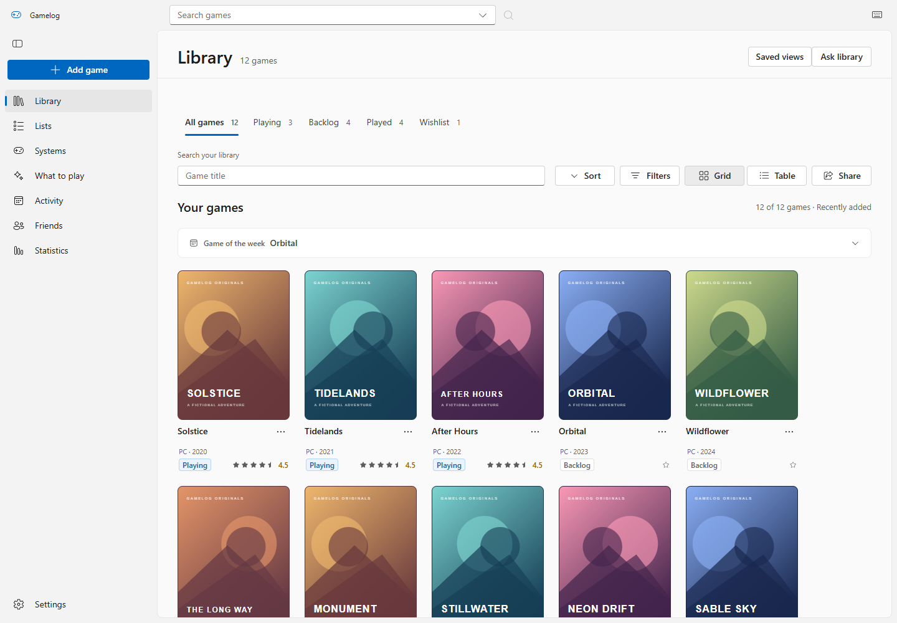
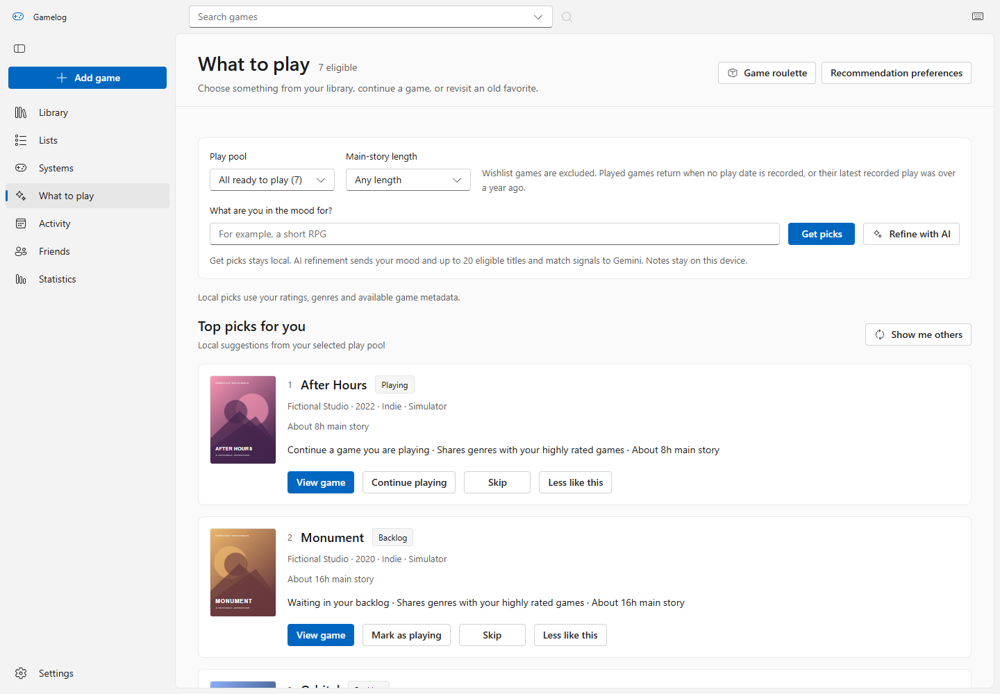
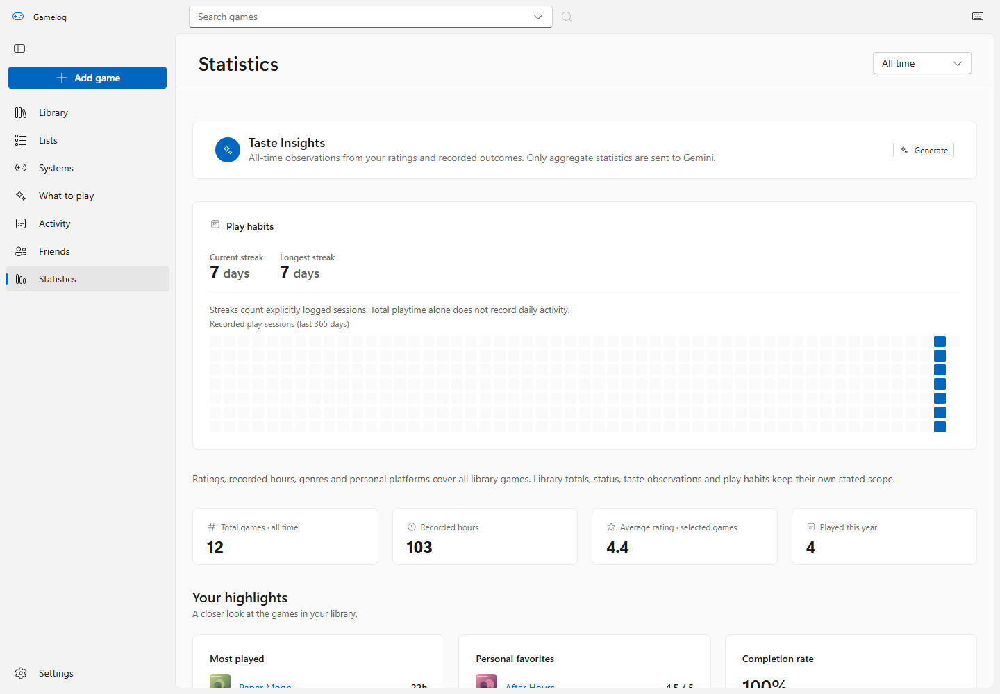

# Gamelog — from a collection to a considered next session

**Personal product design project · Windows desktop · Functional, AI-assisted implementation**

## Context

A game collection serves several needs: remembering what is owned, tracking an experience, and deciding what to play. An undifferentiated backlog makes these jobs compete. Gamelog gives each a clear place while keeping the player's library as the connecting thread.

The design hypothesis is that a useful next choice depends on context: current play status, available time, taste and games already in the collection. This is a product hypothesis, not a validated research finding.

## Scope and contribution

The portfolio work covers information architecture, collection and journal workflows, interaction states, a shared Windows design system, Light/Dark themes, and the translation of those decisions into a functioning app. Microsoft Fluent UI supplies the base component language; project-specific composition, tokens and flows sit above it. Implementation and documentation are AI-assisted. No independent participant study or commercial launch is claimed.

## 1. Keep discovery separate from commitment

Catalog details answer “what is this game?” A personal log answers “what is my relationship to it?” Browsing should not silently become an edit to the collection.

The flow separates preview, Add, review and Save. Cancel leaves the library unchanged. Duplicate additions preserve the existing personal log. Catalog platforms describe availability; recorded platforms describe where the player actually played.

**Tradeoff:** explicit review takes another step, but makes ownership and persistence easier to understand.

## 2. Support recognition and comparison

Cover grids support visual recognition. Tables support comparing ratings, time and status. Status tabs offer a quick first cut; combined filters and saved views handle specific questions without adding permanent navigation items.

Grid/table and sort preferences persist. Empty results offer recovery actions; dense tables contain their own horizontal scrolling on narrow windows. Shared card metadata and status treatments keep repeated information consistent.

**Tradeoff:** two collection views create more states to maintain. Shared data and regression coverage keep their behavior aligned.

## 3. Give recommendations a visible basis

What to play starts with local recommendations. Eligibility and duration constraints apply before ranking. Suggestions identify grounded signals such as genre overlap, an unfinished game or estimated story length. Separate actions let the player view a game, start/continue it, skip it or ask for less like it.

AI refinement is optional and initiated by the player. Generated content is validated, and unavailable AI retains a usable local path. Resume recaps ask for consent to share selected note excerpts; they do not silently upload the entire journal.

**Tradeoff:** local metadata cannot infer every mood. Clear constraints and explanations provide a useful baseline without requiring an external model for the core decision.

## 4. Make the journal trustworthy

Adding a game or changing a rating does not count as playing it. Activity uses recorded sessions; statistics distinguish recorded time, library composition and scoped periods. Missing values remain missing instead of becoming invented progress.

Backups, recoverable removals and undo support corrections. Import validation runs before data changes, and related updates use transactions to avoid half-written records.

**Tradeoff:** accurate summaries sometimes contain less data. Showing a sparse but honest record is preferable to an impressive-looking invented history.

## System thinking

Semantic color roles, a shared type scale, spacing and radius tokens, and common controls connect the experience. Light and Dark retain the same hierarchy. Pending, disabled, empty, failed, saved and recoverable states belong to shared patterns rather than isolated screens.

[Design-system source map and tokens](design-system/README.md)

The [editable Figma design system](https://www.figma.com/design/PFC9DSki5Eyil4oRWc0x7k?node-id=12-2) includes component states and Light/Dark foundations. Explore the [portfolio boards](https://www.figma.com/design/PFC9DSki5Eyil4oRWc0x7k?node-id=13-11), [browse-to-save prototype](https://www.figma.com/proto/PFC9DSki5Eyil4oRWc0x7k?node-id=10-40&starting-point-node-id=10%3A40), or the [exported boards and offline viewer](design-system/README.md) in this repository.

## Evidence and limits

The deliverable is a working app with checks for data integrity, API behavior, keyboard interactions, navigation, themes, responsive containment and desktop persistence. Screenshots are reproducible production captures with fictional content. These establish implemented behavior; they do not establish desirability, adoption or task-efficiency improvements.

[Current verification record](VERIFICATION.md)

The next validation step is a moderated task study: find an owned game, record a session, choose a game within a time limit, and recover an accidental removal. Observe completion, errors and confidence before claiming reduced decision time or improved collection management. Screen-reader, forced-color and high-zoom checks should extend existing keyboard coverage.
