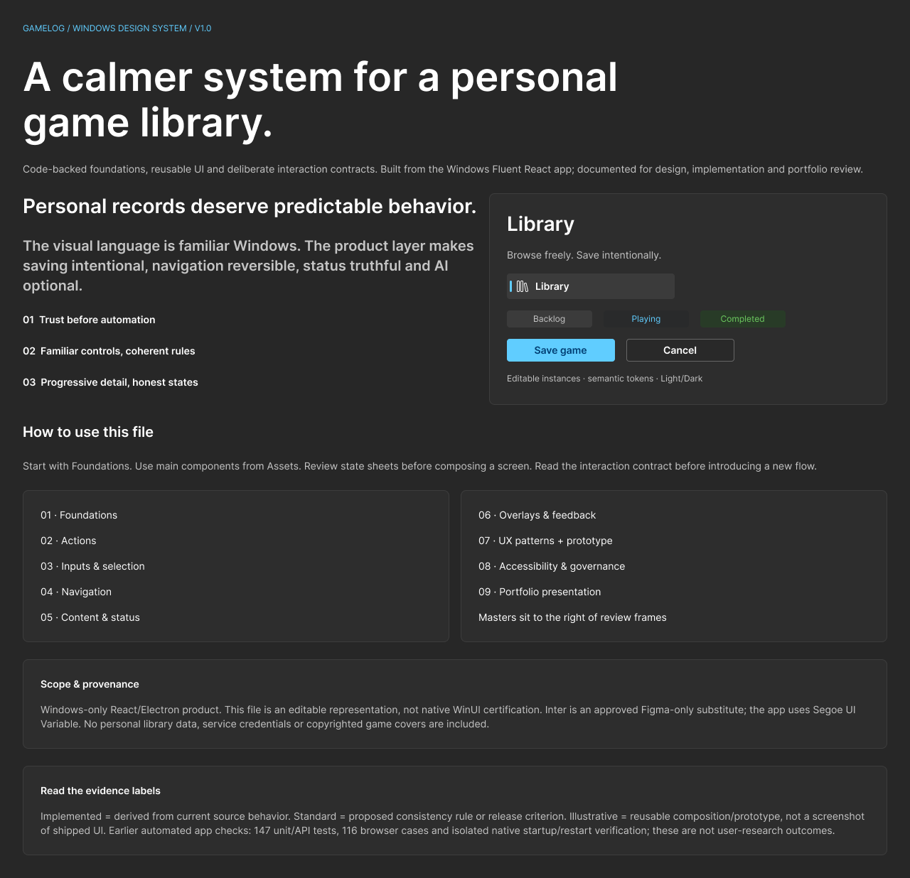
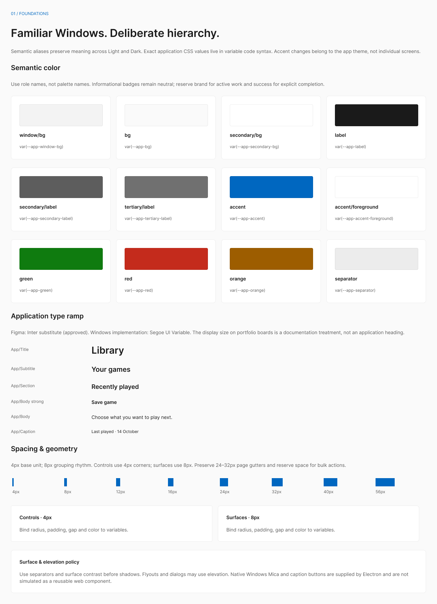
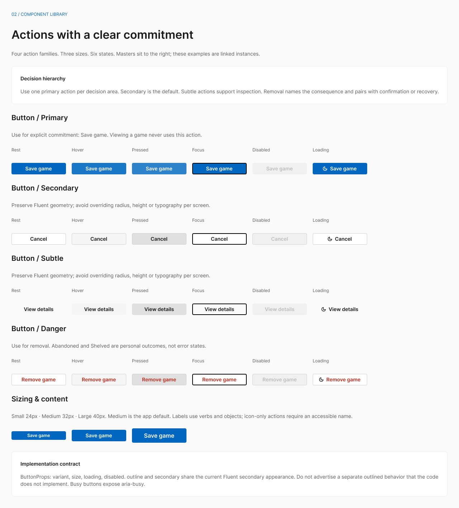
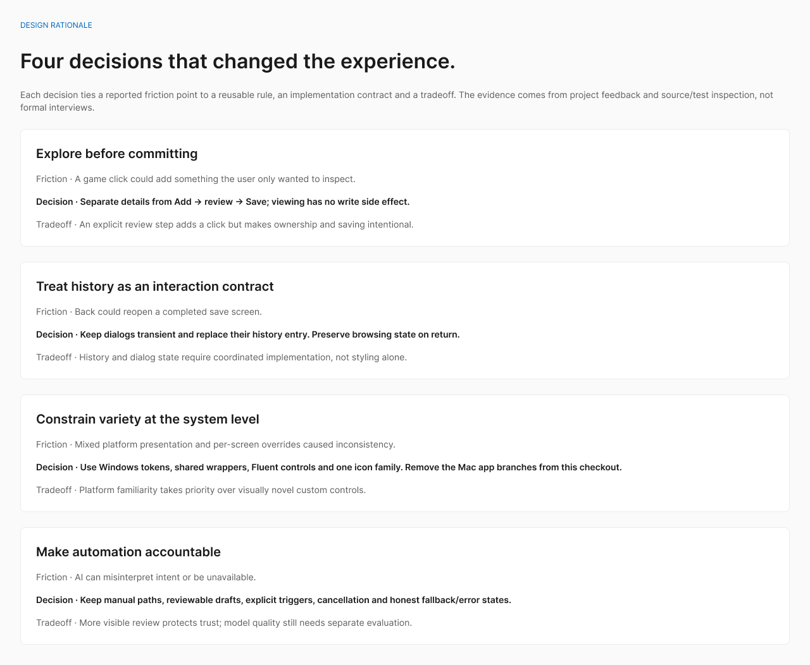
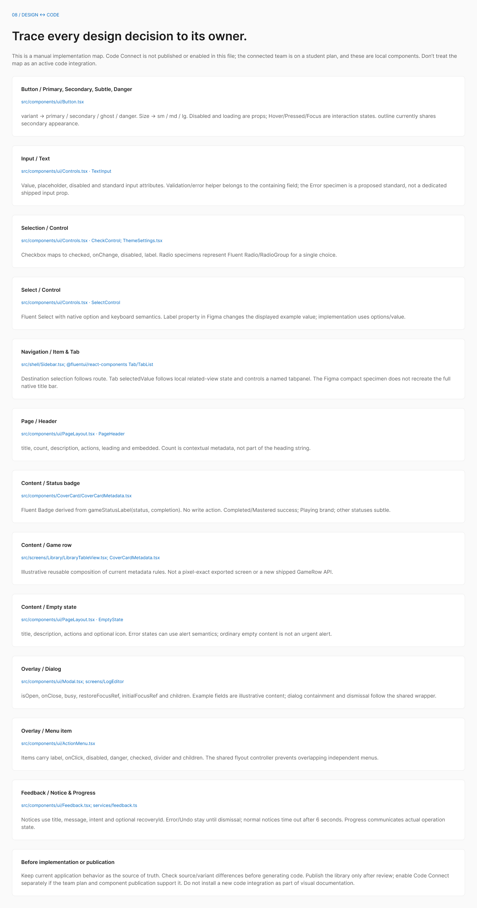

# Gamelog design system

[**Open the editable Figma design system →**](https://www.figma.com/design/PFC9DSki5Eyil4oRWc0x7k?node-id=12-2)

[Portfolio presentation boards](https://www.figma.com/design/PFC9DSki5Eyil4oRWc0x7k?node-id=13-11) · [Browse-to-save prototype](https://www.figma.com/proto/PFC9DSki5Eyil4oRWc0x7k?node-id=10-40&starting-point-node-id=10%3A40) · [Offline viewer](preview/README.md) · [File and node manifest](figma-manifest.json)

The Windows experience builds on Microsoft Fluent UI with project-specific semantic tokens, interaction patterns and page composition. The source is the authority for the functioning app.



## What is included

The v1 Figma snapshot contains 10 pages, 133 variables with Light/Dark semantic modes, 10 text styles, four effect styles, and 17 UI families. Its 131 component masters include 14 Microsoft Fluent icons. The library is editable in Figma; it is a review library, not a published team library.

This repository includes the exported references so reviewers can explore the system without opening Figma:

- **16 presentation boards:** overview, Light/Dark foundations, actions, inputs, navigation, content/status, overlays, UX patterns, accessibility, governance, source mapping, and four portfolio narrative boards.
- **Four prototype screens:** browse, game details, review draft, and saved state. The offline viewer connects their primary actions using fictional content.
- **CSS and JSON tokens:** source-derived snapshots for Windows themes and shared foundations.
- **14 Fluent SVG icons:** with their upstream MIT license.
- **Handoff notes and a manifest:** file/node links, scope, fonts, and representation limits.

The editable components and variables remain in the [Figma file](https://www.figma.com/design/PFC9DSki5Eyil4oRWc0x7k?node-id=12-2). These PNGs and the viewer are reference exports; a native `.fig` file is not included. Figma access follows the file owner's sharing settings.

## Selected boards

| Foundations                                                                      | Actions and interaction states                                                                |
| -------------------------------------------------------------------------------- | --------------------------------------------------------------------------------------------- |
| [](preview/boards/01-light.png) | [](preview/boards/02-actions.png) |

| Product decisions                                                                                     | Design-to-code mapping                                                                               |
| ----------------------------------------------------------------------------------------------------- | ---------------------------------------------------------------------------------------------------- |
| [](preview/boards/09-decisions.png) | [](preview/boards/08-integration.png) |

## Explore locally

After downloading or cloning the repository, open [`preview/index.html`](preview/index.html) in your browser. Keep its surrounding files and folders together. GitHub displays the HTML source; download it to use the interactive viewer.

Alternatively, from the project root:

```sh
node docs/design-system/serve-preview.mjs
```

Open `http://127.0.0.1:5192`. The viewer supports board search, previous/next navigation, actual-size display, PNG downloads, and the four-screen illustrative flow. It needs no API keys. Its prototype fields are static examples and do not save library records.

## Design-to-code source map

| Foundation or pattern                   | Source                                                     |
| --------------------------------------- | ---------------------------------------------------------- |
| Semantic colors, Light/Dark and accents | `src/styles/theme.css`, `src/styles/platforms/windows.css` |
| Typography, spacing and global layout   | `src/styles/globals.css`                                   |
| Fluent theme integration                | `src/platform/PlatformProvider.tsx`                        |
| Actions and form controls               | `src/components/ui/Button.tsx`, `Controls.tsx`             |
| Menus, dialogs and confirmation         | `ActionMenu.tsx`, `Modal.tsx`, `ConfirmDialog.tsx`         |
| Pending, success, failure and undo      | `Feedback.tsx`, `DeferredContent.tsx`                      |
| Cover metadata and status taxonomy      | `src/components/CoverCard/`, `StatusChip.tsx`              |
| Headers, surfaces and empty states      | `src/components/ui/PageLayout.tsx`                         |
| Overlay coordination                    | `src/services/overlay.ts`                                  |

The [CSS](tokens/windows.tokens.css) and [JSON](tokens/windows.tokens.json) snapshots provide portable references. They are documentation snapshots, not automatically synchronized exports. Check current source before implementing changes.

## Interaction principles

- Keep preview and saved records distinct; saving is an explicit commitment.
- Preserve personal records when catalog metadata changes.
- Give pending work a visible state and make failures recoverable.
- Return keyboard focus when dialogs close; use native control semantics.
- Use text and shape alongside color for status and selection.
- Offer clear empty states, cancellation and undo where supported.
- Keep optional AI actions explicit and reviewable, alongside local alternatives.


The app uses system fonts, including Segoe UI Variable on Windows. No font binaries are redistributed. Keyboard checks do not replace a complete accessibility review across assistive technologies, contrast states, forced colors and zoom levels.
