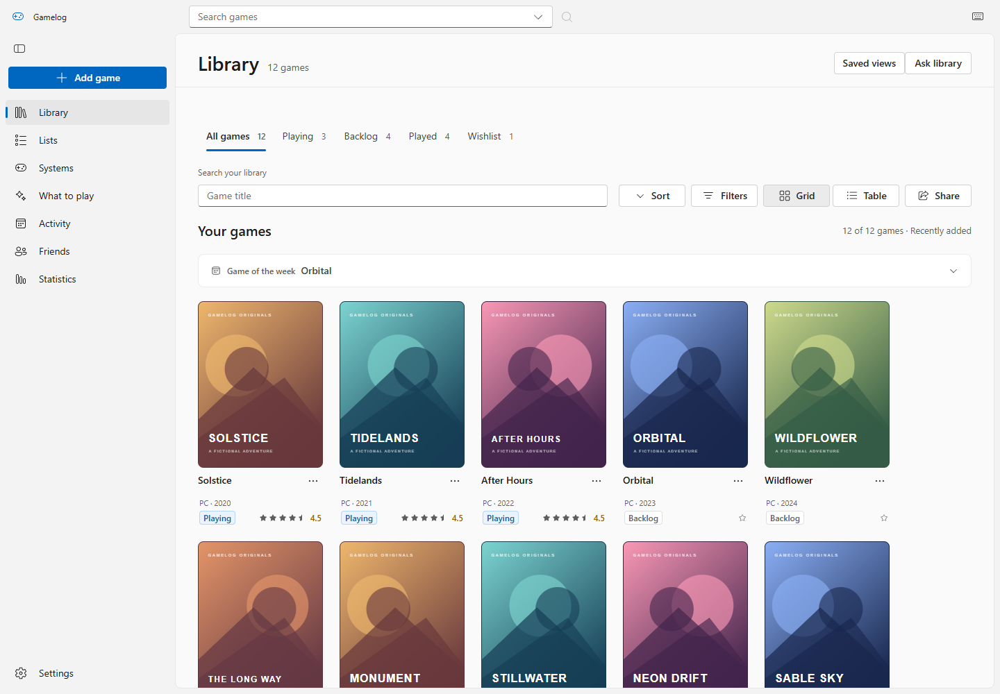
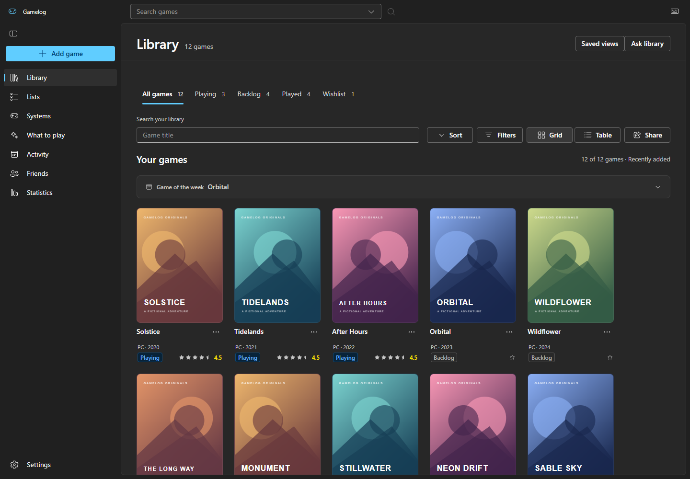

# Gamelog design system

The Windows experience builds on Microsoft Fluent UI with project-specific semantic tokens, interaction patterns and page composition. The source is the authority for the functioning app.

| Foundation or pattern                   | Source                                                     |
| --------------------------------------- | ---------------------------------------------------------- |
| Semantic colors, Light/Dark and accents | `src/styles/theme.css`, `src/styles/platforms/windows.css` |
| Typography, spacing and global layout   | `src/styles/globals.css`                                   |
| Fluent theme integration                | `src/platform/PlatformProvider.tsx`                        |
| Actions and form controls               | `src/components/ui/Button.tsx`, `Controls.tsx`             |
| Menus, dialogs and confirmation         | `ActionMenu.tsx`, `Modal.tsx`, `ConfirmDialog.tsx`         |
| Pending, success, failure and undo      | `Feedback.tsx`, `DeferredContent.tsx`                      |
| Cover metadata and status taxonomy      | `src/components/CoverCard/`, `StatusChip.tsx`              |
| Headers, surfaces and empty states      | `src/components/ui/PageLayout.tsx`                         |
| Overlay coordination                    | `src/services/overlay.ts`                                  |

The [CSS](tokens/windows.tokens.css) and [JSON](tokens/windows.tokens.json) snapshots provide portable references. They are documentation snapshots, not automatically synchronized exports. Check current source before implementing changes.

## Interaction principles

- Keep preview and saved records distinct; saving is an explicit commitment.
- Preserve personal records when catalog metadata changes.
- Give pending work a visible state and make failures recoverable.
- Return keyboard focus when dialogs close; use native control semantics.
- Use text and shape alongside color for status and selection.
- Offer clear empty states, cancellation and undo where supported.
- Keep optional AI actions explicit and reviewable, alongside local alternatives.

The app uses system fonts, including Segoe UI Variable on Windows. No font binaries are redistributed. Keyboard checks do not replace a complete accessibility review across assistive technologies, contrast states, forced colors and zoom levels.
